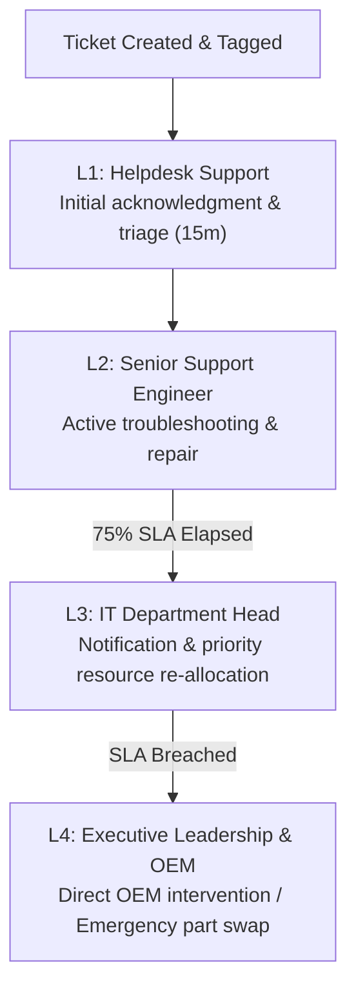

# Laxmi Samadhan (LIFC) – IT Hardware & Software SLA Master Policy

This document defines the official Service Level Agreements (SLAs), category and sub-category taxonomies, priority definitions, resolution targets, and escalation matrices for the **IT Hardware** and **IT Software** departments.

---

## 1. Priority Definitions

| Priority Tier | Classification | Criteria & Business Impact | Target Initial Response |
| :--- | :--- | :--- | :--- |
| **P1 – Critical** | Critical Outage / Blocker | Work-stoppage affecting business-critical functions, multiple users, or disbursal/cash/legal transactions without workaround. | **15 Minutes** |
| **P2 – High** | Major Impairment | Core hardware/software failure affecting an individual user’s primary device or critical tool; no immediate workaround available. | **30 Minutes** |
| **P3 – Medium** | Moderate / Individual Workaround | Degradation of service or failure with an existing temporary workaround (e.g., peripheral replacement, normal printing). | **60 Minutes** |
| **P4 – Low** | Planned Service Request | Planned hardware installation, new software requests, asset inventory, or documentation updates. | **240 Minutes (4 hrs)** |

---

## 2. IT Hardware Support SLA Matrix (20 Defined Scenarios)

All response and resolution SLAs operate under standard business hours (09:30 AM to 06:30 PM IST), excluding Sundays and statutory bank holidays.

| # | Sub-Category | Specific Sub-Issue | Priority | Response SLA | Target Resolution SLA | Primary Support Group |
|---|:---|:---|:---:|:---:|:---:|:---|
| 1 | **Desktop** | Desktop / PC not working | **P1 – Critical** | 15 mins | **4 Hours (240m)** | Vendor Support-FMS |
| 2 | **Laptop** | Laptop not starting | **P2 – High** | 30 mins | **4 Hours (240m)** | Vendor Support-FMS |
| 3 | **Peripheral** | Keyboard / Mouse not working | **P3 – Medium** | 60 mins | **8 Hours (480m)** | Vendor Support-FMS |
| 4 | **Monitor / Display** | Monitor / Display issue | **P2 – High** | 30 mins | **4 Hours (240m)** | Vendor Support-FMS |
| 5 | **Printer** | Printer not working – critical department | **P1 – Critical** | 15 mins | **2 Hours (120m)** | Vendor Support-FMS |
| 6 | **Printer** | Printer not working – normal user | **P3 – Medium** | 60 mins | **8 Hours (480m)** | Vendor Support-FMS |
| 7 | **Network Hardware** | Network cable / LAN port hardware issue | **P2 – High** | 30 mins | **4 Hours (240m)** | Internal IT / FMS |
| 8 | **Peripheral** | Docking station / Adapter issue | **P3 – Medium** | 60 mins | **8 Hours (480m)** | Vendor Support-FMS |
| 9 | **Power / UPS** | UPS / Power backup issue | **P2 – High** | 30 mins | **4 Hours (240m)** | Vendor Support-FMS |
| 10 | **Desktop** | Hardware overheating / Fan noise | **P2 – High** | 30 mins | **4 Hours (240m)** | Vendor Support-FMS |
| 11 | **Desktop** | RAM / HDD / SSD failure | **P2 – High** | 30 mins | **8 Hours (480m)** | Vendor Support-FMS |
| 12 | **Desktop** | Blue screen / Hardware crash | **P2 – High** | 30 mins | **4 Hours (240m)** | Vendor Support-FMS |
| 13 | **Peripheral** | Webcam / Microphone hardware issue | **P3 – Medium** | 60 mins | **8 Hours (480m)** | Vendor Support-FMS |
| 14 | **Laptop** | Laptop battery issue | **P3 – Medium** | 60 mins | **1 Business Day (480m)** | Vendor Support-FMS |
| 15 | **Laptop** | Physical damage to device | **P3 – Medium** | 120 mins | **1–3 Business Days (1440m)** | Vendor Support-AMC |
| 16 | **Hardware Procurement** | New hardware installation | **P4 – Low** | 240 mins | **2–3 Business Days (2880m)** | Vendor Support-FMS |
| 17 | **Hardware Replacement** | Hardware replacement request | **P3 – Medium** | 60 mins | **1–3 Business Days (1440m)** | Vendor Support-FMS |
| 18 | **Warranty & Support** | Warranty / OEM service coordination | **P3 – Medium** | 120 mins | **3–5 Business Days (4320m)** | OEM / Vendor Support-AMC |
| 19 | **Asset Management** | Hardware inventory / Asset tagging | **P4 – Low** | 240 mins | **2 Business Days (2880m)** | Internal IT Admin |
| 20 | **Peripheral** | Peripheral / USB port issue | **P3 – Medium** | 60 mins | **8 Hours (480m)** | Vendor Support-FMS |

---

## 3. IT Software Support SLA Matrix (14 Enterprise Scenarios)

| # | Sub-Category | Specific Sub-Issue / System | Priority | Response SLA | Target Resolution SLA | Primary Support Group |
|---|:---|:---|:---:|:---:|:---:|:---|
| 1 | **LOS (Loan Origination System)** | LOS Application Down / Critical Error | **P1 – Critical** | 15 mins | **2 Hours (120m)** | Internal IT Support |
| 2 | **LMS (Loan Management System)** | LMS Repayment / Disbursal Posting Error | **P1 – Critical** | 15 mins | **2 Hours (120m)** | Internal IT Support |
| 3 | **CLU-collection** | CLU Collection App / Receipt Sync Issue | **P1 – Critical** | 15 mins | **2 Hours (120m)** | Internal IT Support |
| 4 | **Core Applications** | Core Banking / Payment Gateway Sync Failure | **P1 – Critical** | 15 mins | **2 Hours (120m)** | Internal IT Support |
| 5 | **CRM** | CRM Customer Lead / KYC Processing Error | **P2 – High** | 30 mins | **4 Hours (240m)** | Internal IT Support |
| 6 | **Operating System & Drivers** | Operating System / Blue Screen / Corrupted OS | **P2 – High** | 30 mins | **4 Hours (240m)** | Internal IT Support |
| 7 | **Productivity Software** | Email / Outlook Access / Exchange Connection Issue | **P2 – High** | 30 mins | **4 Hours (240m)** | Internal IT Support |
| 8 | **Browser & Portals** | Digital Signature (DSC) / Java / Browser Certificate Error | **P2 – High** | 30 mins | **4 Hours (240m)** | Internal IT Support |
| 9 | **Security Software** | Antivirus / Security Patch Installation Failure | **P2 – High** | 30 mins | **4 Hours (240m)** | Digital Security Team |
| 10 | **Software Licenses** | Software License Allocation (MS Office, Adobe, etc.) | **P3 – Medium** | 60 mins | **8 Hours (480m)** | Software Licensing Team |
| 11 | **User Permissions** | User Role / Permission Update Request | **P3 – Medium** | 60 mins | **8 Hours (480m)** | Internal IT Support |
| 12 | **Reports & MIS** | Custom Report / MIS Export Issue | **P3 – Medium** | 60 mins | **1 Business Day (1440m)** | MIS / Analytics Team |
| 13 | **Data Management** | Data Correction / Rectification Request | **P3 – Medium** | 60 mins | **1 Business Day (1440m)** | Database Administrator |
| 14 | **Software Installation** | New Software Installation Request | **P4 – Low** | 240 mins | **2 Business Days (2880m)** | Internal IT Support |

---

## 4. 4-Tier Escalation Hierarchy

Every SLA policy in the portal incorporates automated multi-tiered notifications and escalations:



1. **L1 – IT Helpdesk (Immediate / Response Threshold)**:
   - Acknowledges ticket, verifies details, performs remote initial triage.
2. **L2 – Field / System Support (Active Work Phase)**:
   - Responsible for on-site hardware diagnosis, part replacement, or application database troubleshooting.
3. **L3 – IT Manager / Department Head (75% Elapsed Warning)**:
   - Automated notification triggers when 75% of the resolution SLA window has expired without ticket closure.
   - Manager reviews blocker, reallocates technical resources, or contacts vendor reps directly.
4. **L4 – Management & OEM Escalation (SLA Breach Trigger)**:
   - Escalates directly upon breach.
   - Triggers vendor penalty clause review, emergency device swap, or vendor on-site dispatch.

---

## 5. Deployment & Execution Instructions

### Option A: Run Prisma Seed via TypeScript
Run from the `backend/` directory:
```bash
npm run prisma:seed
```
Or directly run the dedicated script:
```bash
npx tsx src/scripts/seed_hardware_software_sla.ts
```

### Option B: Execute Pure SQL in Production Database
When deploying directly to production via PostgreSQL client (`psql` or pgAdmin):
```bash
psql -U postgres -d ticket_portal -f backend/prisma/seed_sla_policies.sql
```
This script uses safe `ON CONFLICT` statements and preserves all existing system data while updating/creating all 34 SLA policies and category configurations.
